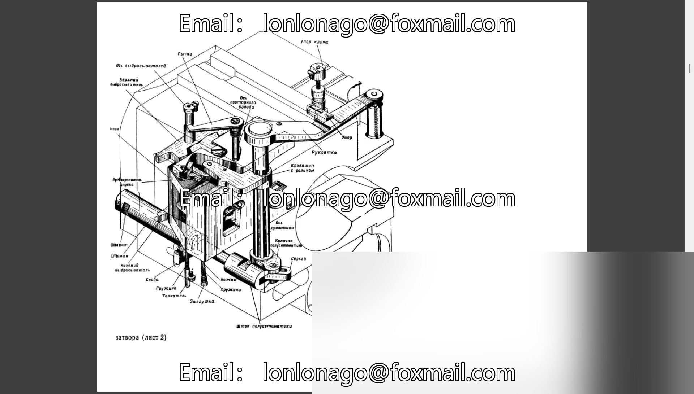

# T-90 main combat tank series of core technical documents totaled 6 volumes.

## Body

T-90 main battle tank series of core technical document volumes total 6.
It covers operating guides for the tank's gun, key subsystems, and different models.
1. Firearm system technical documents
《T-90 125mm tank gun 2A46M and 2A46M-1》 (1984)
Content: The early technical specifications for the 125mm main gun used by the T-90 and its predecessor T-72, which is the foundation for understanding its firepower system.
《T-90 125mm tank gun 2A46M》 (2016)
Content: The updated technical handbook for the same main gun, which may include the latest maintenance standards, improvement details, or operation procedures.

2.  Key subsystem manual
"T-90. Structure and function of tank auto-loading machine"

Content: Specifically explains the automatic muzzleloader of the T-90. This is the core subsystem of the tank. Responsible for improving shooting accuracy and passenger safety. The manual will cover its mechanical structure Process workflow and maintenance key points.

3. Operation and usage guide for each model

"The T-90S Tank. Operating Manual. Volume 1" (1992)

Content: The early official operational manual of the T-90S (export version), covering vehicle descriptions, driving, daily maintenance, and basic combat operations, serves as a foundation for understanding this model.

"T-90M. Part One: Tank Description and Operation" (Technical Text)

Content: The detailed technical description of the latest improved T-90M "Breakthrough," involving descriptions and operation methods of all subsystems such as new fire control, armour, and communication.

《T-90M. Part II: Usage Description》 (technical text)

Content: Describes the combat usage of the T-90M, which may include tactical deployment, usage norms of weapon systems in various combat scenarios, combat limitations, etc.
This list constitutes a complete technical material system from basic components (howitzers) to key subsystems (loading machines), and then to the full vehicle model (T-90S/T-90M) operation and tactical usage.

or exchange once sold.

The documents cover T-90 main battle tank firearms, key subsystem guides and operating guides for different model variants, forming a complete technical resource system.

<!-- AI_ENRICHED -->

## Images

## Payment

Here is a pay link on Stripe ( https://buy.stripe.com/3cs8yP7sY87d0vu9AB ). Please contact me lonlonago@foxmail.com after funding $89, and I will send you a complete data files , thank you!

